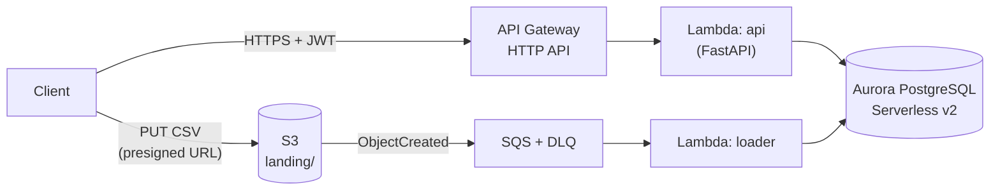

# Globant Data Engineering Coding Challenge

REST API that migrates historical CSV data (`departments`, `jobs`, `hired_employees`) into a SQL
database and supports batch inserts of 1 to 1000 rows per request.

The solution is built **local-first and cloud-ready**: it runs locally with Docker, and the same
code and container image target a serverless architecture on **AWS**.

## Table of contents

- [Challenge scope](#challenge-scope)
- [Tech stack](#tech-stack)
- [Repository structure](#repository-structure)
- [Getting started](#getting-started)
  - [Local environment](#local-environment)
  - [Configuration](#configuration)
- [Architecture](#architecture)
- [Development workflow](#development-workflow)
- Data model _(coming soon)_
- API reference _(coming soon)_
- Data quality rules _(coming soon)_
- Assumptions _(coming soon)_

## Challenge scope

| Section | Deliverable | Status |
|---|---|---|
| 1. API | Receive historical data from CSV files | ⏳ In progress |
| 1. API | Upload the files to the new SQL database | ⏳ In progress |
| 1. API | Insert batch transactions (1 to 1000 rows) in one request | ⏳ In progress |
| 2. SQL | Hires per job and department in 2021 by quarter | 🔜 Pending |
| 2. SQL | Departments that hired above the 2021 mean | 🔜 Pending |
| Bonus | Cloud hosting (AWS), automated tests, containers | 🔜 Pending |

## Tech stack

| Concern | Choice | Why |
|---|---|---|
| Language | Python 3.12 | Data engineering ecosystem, typing, AWS Lambda support |
| API framework | FastAPI | Pydantic validation and automatic OpenAPI docs |
| Validation | Pydantic v2 | Per-row validation of CSV records and request payloads |
| Configuration | pydantic-settings | Typed settings from environment variables, same config locally and on AWS |
| Database | PostgreSQL (Aurora PostgreSQL Serverless v2 on AWS) | Transactional workload, native upsert (`ON CONFLICT`), rich analytical SQL |
| Local infrastructure | Docker Compose | PostgreSQL 16 with healthcheck, matching the Aurora major version |
| Package manager | [uv](https://docs.astral.sh/uv/) | Fast, reproducible installs with a lockfile |
| Lint / format | Ruff | Single fast tool for linting and formatting |
| Tests | pytest | De facto standard for Python testing |

## Repository structure

```
.
├── app/
│   ├── api/           # HTTP layer (FastAPI routers)
│   ├── core/          # Ingestion logic: CSV parsing, validation, loading (no HTTP/AWS deps)
│   ├── db/            # SQLAlchemy models, session and repositories
│   ├── handlers/      # AWS Lambda entry points (event-driven loader)
│   ├── config.py      # Settings from environment variables
│   └── main.py        # FastAPI application factory
├── docs/              # Architecture and design decisions
├── tests/
│   ├── unit/          # Fast tests, no external services
│   └── integration/   # Tests against a real PostgreSQL
├── .env.example       # Configuration template
├── docker-compose.yml # Local PostgreSQL
├── Makefile           # Common developer commands
└── pyproject.toml     # Dependencies and tool configuration
```

## Getting started

Prerequisites:

- [uv](https://docs.astral.sh/uv/getting-started/installation/) (installs Python 3.12 if needed)
- Docker with Compose v2 (Docker Desktop, Colima or OrbStack)

```bash
make install   # create .venv and install dependencies
make up        # start PostgreSQL 16 and wait until it is healthy
make run       # start the API on http://localhost:8000
```

Open the interactive docs at http://localhost:8000/docs and check the liveness probe:

```bash
curl http://localhost:8000/health
# {"status":"ok"}
```

### Local environment

| Command | What it does |
|---|---|
| `make up` | Starts PostgreSQL (`globant-db` container) and waits for its healthcheck |
| `make psql` | Opens a `psql` shell in the local database |
| `make logs` | Follows the database logs |
| `make down` | Stops the containers; data persists in the `pgdata` volume |

To wipe the local data, run `docker compose down -v`.

### Configuration

Settings are read from environment variables, or from a `.env` file
(copy [`.env.example`](.env.example)). The same variables are used locally and on AWS.

| Variable | Default | Description |
|---|---|---|
| `DATABASE_URL` | _(unset)_ | Full SQLAlchemy URL; takes precedence over the `DB_*` variables |
| `DB_HOST` | `localhost` | Database host |
| `DB_PORT` | `5432` | Database port (also the host port published by Docker Compose) |
| `DB_NAME` | `globant` | Database name |
| `DB_USER` | `postgres` | Database user |
| `DB_PASSWORD` | `postgres` | Database password (local only; AWS uses IAM database authentication) |
| `APP_ENV` | `local` | One of `local`, `test`, `dev`, `prod` |
| `LOG_LEVEL` | `INFO` | Logging level |

## Architecture

The API runs locally with Docker and targets a **serverless, pay-per-use architecture on AWS**,
chosen because a data migration is a sporadic, bursty workload with long idle periods.



| Concern | Decision |
|---|---|
| Compute | AWS Lambda (arm64, container image) behind API Gateway HTTP API |
| CSV ingestion | Direct upload to S3 with presigned URLs → SQS → loader Lambda |
| Database | Aurora PostgreSQL Serverless v2 (scales to zero) |
| Networking | Private subnets, no NAT Gateway, IAM database authentication |
| Authentication | Amazon Cognito JWT authorizer at API Gateway |
| Infrastructure as code | Terraform |

Idle cost is estimated at **~1–3 USD/month**, versus ~70–80 USD/month for an always-on container
stack. Full details, data flows, cost model and architecture decision records (ADRs):
**[docs/architecture.md](docs/architecture.md)**.

## Development workflow

```bash
make lint      # ruff check + format check
make format    # auto-fix and format
make test      # run the test suite
```

- One `feature/*` branch per step, merged into `main` through a Pull Request.
- Commit messages follow [Conventional Commits](https://www.conventionalcommits.org/).
