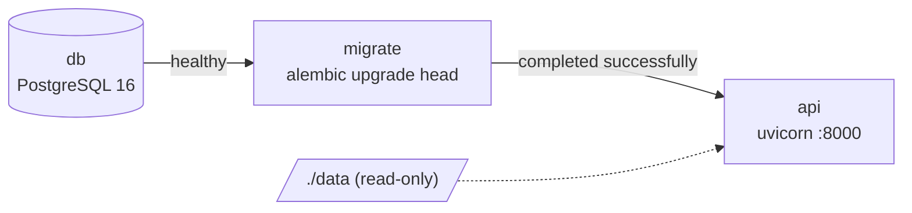
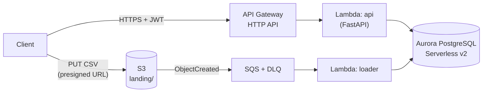
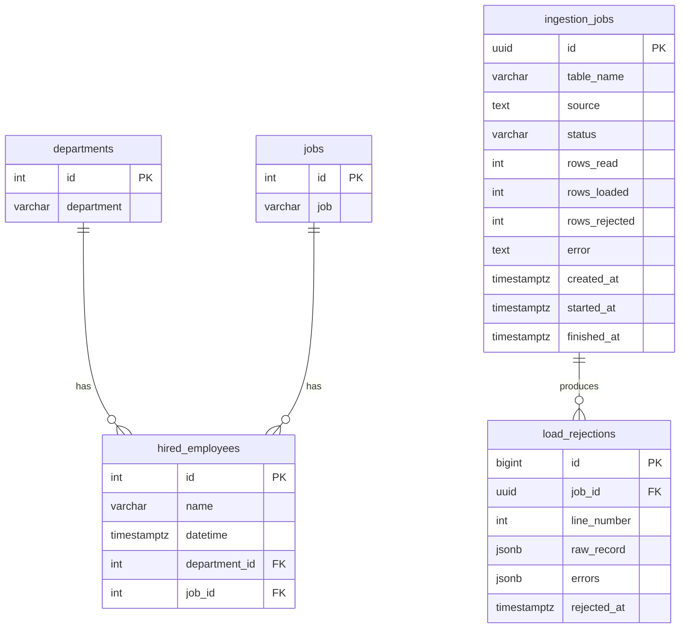
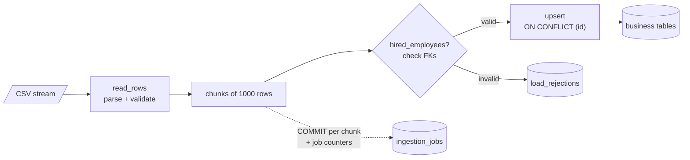

# Globant Data Engineering Coding Challenge

REST API that migrates historical CSV data (`departments`, `jobs`, `hired_employees`) into a SQL
database and supports batch inserts of 1 to 1000 rows per request.

The solution is built **local-first and cloud-ready**: it runs locally with Docker, and the same
code and container image target a serverless architecture on **AWS**.

## Table of contents

- [Challenge scope](#challenge-scope)
- [Tech stack](#tech-stack)
- [Repository structure](#repository-structure)
- [Getting started](#getting-started)
  - [Local environment](#local-environment)
  - [Configuration](#configuration)
  - [Run with Docker](#run-with-docker)
- [Architecture](#architecture)
- [Data model](#data-model)
- [Data quality rules](#data-quality-rules)
  - [Sample data profile](#sample-data-profile)
- [Ingestion pipeline](#ingestion-pipeline)
- [API reference](#api-reference)
- [Development workflow](#development-workflow)
- Assumptions _(coming soon)_

## Challenge scope

| Section | Deliverable | Status |
|---|---|---|
| 1. API | Receive historical data from CSV files | ✅ Done |
| 1. API | Upload the files to the new SQL database | ✅ Done |
| 1. API | Insert batch transactions (1 to 1000 rows) in one request | ✅ Done |
| 2. SQL | Hires per job and department in 2021 by quarter | 🔜 Pending |
| 2. SQL | Departments that hired above the 2021 mean | 🔜 Pending |
| Bonus | Automated tests | ✅ Done (unit + integration) |
| Bonus | Containerize the application (Dockerfile) | ✅ Done |
| Bonus | Cloud hosting (AWS) | 🔜 Pending |

## Tech stack

| Concern | Choice | Why |
|---|---|---|
| Language | Python 3.12 | Data engineering ecosystem, typing, AWS Lambda support |
| API framework | FastAPI | Pydantic validation and automatic OpenAPI docs |
| Validation | Pydantic v2 | Per-row validation of CSV records and request payloads |
| ORM / SQL toolkit | SQLAlchemy 2 + psycopg 3 | Typed models, dialect-specific upserts, connection pooling |
| Schema migrations | Alembic | Versioned, reviewable schema changes |
| Configuration | pydantic-settings | Typed settings from environment variables, same config locally and on AWS |
| Database | PostgreSQL (Aurora PostgreSQL Serverless v2 on AWS) | Transactional workload, native upsert (`ON CONFLICT`), rich analytical SQL |
| Containers | Docker (multi-stage) + Docker Compose | One image for local and AWS Lambda; PostgreSQL 16 matches the Aurora major version |
| Package manager | [uv](https://docs.astral.sh/uv/) | Fast, reproducible installs with a lockfile |
| Lint / format | Ruff | Single fast tool for linting and formatting |
| Tests | pytest + testcontainers | Unit tests plus integration tests against a real PostgreSQL |

## Repository structure

```
.
├── app/
│   ├── api/           # HTTP layer (FastAPI routers)
│   ├── core/          # Ingestion logic: CSV parsing, validation, loading (no HTTP/AWS deps)
│   ├── db/            # SQLAlchemy models, session and repositories
│   ├── handlers/      # AWS Lambda entry points (event-driven loader)
│   ├── config.py      # Settings from environment variables
│   └── main.py        # FastAPI application factory
├── data/              # CSV files provided with the challenge (no header)
├── docs/              # Architecture and design decisions
├── migrations/        # Alembic environment and versioned migrations
├── tests/
│   ├── unit/          # Fast tests, no external services
│   └── integration/   # Tests against a real PostgreSQL
├── .env.example       # Configuration template
├── Dockerfile         # Multi-stage API image (local + AWS Lambda)
├── alembic.ini        # Alembic configuration (URL comes from settings)
├── docker-compose.yml # PostgreSQL, migrations job and containerized API
├── Makefile           # Common developer commands
└── pyproject.toml     # Dependencies and tool configuration
```

## Getting started

Prerequisites:

- [uv](https://docs.astral.sh/uv/getting-started/installation/) (installs Python 3.12 if needed)
- Docker with Compose v2 (Docker Desktop, Colima or OrbStack)

```bash
make install   # create .venv and install dependencies
make up        # start PostgreSQL 16 and wait until it is healthy
make migrate   # create the schema (alembic upgrade head)
make run       # start the API on http://localhost:8000
```

Migrate the historical CSV files in [`data/`](data/) with one request:

```bash
curl -X POST http://localhost:8000/api/v1/ingestions/historical
```

Open the interactive docs at http://localhost:8000/docs and check the liveness probe:

```bash
curl http://localhost:8000/health
# {"status":"ok"}
```

### Local environment

| Command | What it does |
|---|---|
| `make up` | Starts PostgreSQL (`globant-db` container) and waits for its healthcheck |
| `make psql` | Opens a `psql` shell in the local database |
| `make logs` | Follows the database logs |
| `make down` | Stops every container; data persists in the `pgdata` volume |

To wipe the local data, run `docker compose down -v`.

### Configuration

Settings are read from environment variables, or from a `.env` file
(copy [`.env.example`](.env.example)). The same variables are used locally and on AWS.

| Variable | Default | Description |
|---|---|---|
| `DATABASE_URL` | _(unset)_ | Full SQLAlchemy URL; takes precedence over the `DB_*` variables |
| `DB_HOST` | `localhost` | Database host |
| `DB_PORT` | `5432` | Database port (also the host port published by Docker Compose) |
| `DB_NAME` | `globant` | Database name |
| `DB_USER` | `postgres` | Database user |
| `DB_PASSWORD` | `postgres` | Database password (local only; AWS uses IAM database authentication) |
| `LOCAL_DATA_DIR` | `data` | Server directory read by the historical migration endpoint |
| `MAX_UPLOAD_MB` | `50` | Maximum size of an uploaded CSV file |
| `APP_ENV` | `local` | One of `local`, `test`, `dev`, `prod` |
| `LOG_LEVEL` | `INFO` | Logging level |

### Run with Docker

Run exactly what gets deployed: the API image, with migrations applied by a one-off job.

```bash
make stack       # PostgreSQL -> migrate job -> API on http://localhost:8000
curl -X POST http://localhost:8000/api/v1/ingestions/historical
make stack-down
```



| Image feature | Why |
|---|---|
| Multi-stage build with `uv sync --frozen --no-dev` | Reproducible, production-only dependencies; build tools stay out of the runtime image |
| Dependencies installed before the code is copied | The dependency layer is cached until `pyproject.toml` or `uv.lock` change |
| Non-root user (`uid 10001`) | Least privilege inside the container |
| `HEALTHCHECK` on `/health` | Compose and orchestrators know when the API is ready |
| AWS Lambda Web Adapter extension | The same image runs on Lambda behind API Gateway ([ADR-001](docs/architecture.md#adr-001--serverless-lambda-over-containers-ecs-fargate)); it is inactive outside Lambda |
| Pre-compiled bytecode | Faster cold starts on Lambda |
| Migrations in a separate one-off job | Several replicas or Lambdas never race to migrate, and startup stays fast |

`data/` is mounted read-only for the historical migration; it is not baked into the image.
To build the image alone: `make image`.

## Architecture

The API runs locally with Docker and targets a **serverless, pay-per-use architecture on AWS**,
chosen because a data migration is a sporadic, bursty workload with long idle periods.



| Concern | Decision |
|---|---|
| Compute | AWS Lambda (arm64, container image) behind API Gateway HTTP API |
| CSV ingestion | Direct upload to S3 with presigned URLs → SQS → loader Lambda |
| Database | Aurora PostgreSQL Serverless v2 (scales to zero) |
| Networking | Private subnets, no NAT Gateway, IAM database authentication |
| Authentication | Amazon Cognito JWT authorizer at API Gateway |
| Infrastructure as code | Terraform |

Idle cost is estimated at **~1–3 USD/month**, versus ~70–80 USD/month for an always-on container
stack. Full details, data flows, cost model and architecture decision records (ADRs):
**[docs/architecture.md](docs/architecture.md)**.

## Data model



**Business tables** (`departments`, `jobs`, `hired_employees`) mirror the CSV files:

- Primary keys are the ids from the source system; they are never generated, so the migration
  preserves them.
- Every business column is `NOT NULL`, and `hired_employees` has foreign keys to `departments`
  and `jobs`.
- `datetime` is stored as `timestamptz`: the source values are UTC (`Z` suffix), which makes the
  quarter calculations of Section 2 unambiguous.
- Indexes on `datetime`, `department_id` and `job_id` support the yearly filters and joins of the
  Section 2 metrics.

**Ingestion audit tables**:

- `ingestion_jobs`: one row per CSV load with its source, lifecycle
  (`PENDING → RUNNING → SUCCEEDED | FAILED`) and row counters.
- `load_rejections`: every row that failed validation, with the original values and the errors,
  linked to its load. Deleting a job cascades to its rejections.

### Migrations

The schema is managed with [Alembic](https://alembic.sqlalchemy.org/). Constraint and index names
follow a fixed naming convention (`pk_`, `fk_`, `ix_`, `ck_`), so migrations are deterministic.

```bash
make migrate                         # apply pending migrations
make revision m="add column x"       # autogenerate a migration from model changes
uv run alembic downgrade -1          # roll back the last migration
```

An integration test fails if the models and the migrations drift apart.

## Data quality rules

Every CSV row and every batch record is validated with the same Pydantic schemas
([`app/core/schemas.py`](app/core/schemas.py)). Valid rows are loaded; invalid rows are **kept with
their errors** in `load_rejections` instead of being silently dropped
([ADR-004](docs/architecture.md#adr-004--invalid-rows-are-quarantined-not-dropped)).

| Rule | Applies to | Rejected example |
|---|---|---|
| Exact number of columns (2 or 5) | all tables | `1,Sales,extra` |
| Required fields cannot be empty | all fields | `157,Kellia Barribal,,4,61` → `datetime: Field required` |
| Ids are positive integers | `id`, `department_id`, `job_id` | `abc`, `0`, `-1`, `1.5` |
| ISO 8601 datetime **with timezone**, normalized to UTC | `datetime` | `2021-07-27T16:02:08` (no timezone), `1627401728` |
| Text is trimmed and must have 1 to 255 characters | `department`, `job`, `name` | `"   "` |
| No unknown fields | batch payloads | `{"id": 1, "job": "x", "salary": 10}` |
| Referenced department and job must exist | `hired_employees` | checked against the database at load time |

File handling: files are read as a stream (constant memory), CSV quoting is honored (values may
contain commas), and CRLF line endings, a UTF-8 BOM, blank lines and an optional header row are
supported. Errors keep the physical line number of the file.

### Sample data profile

Profile of the files in [`data/`](data/), verified by
[`tests/unit/test_sample_data.py`](tests/unit/test_sample_data.py):

| File | Rows | Valid | Rejected |
|---|---|---|---|
| `departments.csv` | 12 | 12 | 0 |
| `jobs.csv` | 183 | 183 | 0 |
| `hired_employees.csv` | 1,999 | 1,929 | **70** |

The 70 rejected employees each miss exactly one field: `department_id` (21), `name` (19),
`job_id` (16) and `datetime` (14). All valid rows reference existing departments and jobs, and
there are no duplicated ids.

## Ingestion pipeline

The ingestion core ([`app/core/loader.py`](app/core/loader.py)) is shared by every entry point:
the local upload endpoint and, on AWS, the S3-triggered loader Lambda.



1. An `ingestion_jobs` row is created (`PENDING`) and moved to `RUNNING`.
2. The file is streamed and validated row by row, in chunks of 1000 rows.
3. For `hired_employees`, referenced departments and jobs are checked with one query per chunk;
   unknown ids are rejected with a reason such as `department_id: 99 does not exist`.
4. Valid rows are written with `INSERT ... ON CONFLICT (id) DO UPDATE`; invalid rows go to
   `load_rejections` with their line number, raw values and errors.
5. Each chunk is committed together with the job counters (`rows_read`, `rows_loaded`,
   `rows_rejected`). The job ends as `SUCCEEDED`, or `FAILED` with the error message.

**Why commit per chunk instead of one transaction per file?** Short transactions keep memory and
locks bounded for files of any size, and progress is visible while a large file loads. The cost,
partially loaded data after a failure, is neutralized by **idempotent upserts**: re-running the
load completes it without duplicates. That is also the behavior required by SQS, which delivers
messages at least once.

Other rules:

- A repeated id within a file keeps its **last** occurrence, like successive upserts would.
- `rows_loaded` counts accepted rows, including repeated ids that overwrite each other.

## API reference

Interactive OpenAPI documentation is served at http://localhost:8000/docs.

| Method | Path | Description |
|---|---|---|
| `GET` | `/health` | Liveness probe |
| `POST` | `/api/v1/ingestions/historical` | Migrate the three CSV files from `LOCAL_DATA_DIR`, in dependency order |
| `POST` | `/api/v1/ingestions/{table}` | Upload a CSV file and load it into `departments`, `jobs` or `hired_employees` |
| `GET` | `/api/v1/ingestions/{job_id}` | Status and counters of an ingestion job |
| `GET` | `/api/v1/ingestions/{job_id}/rejections` | Rows rejected by a job, paginated |
| `POST` | `/api/v1/departments/batch` | Insert or update 1 to 1000 departments in one transaction |
| `POST` | `/api/v1/jobs/batch` | Insert or update 1 to 1000 jobs in one transaction |
| `POST` | `/api/v1/hired_employees/batch` | Insert or update 1 to 1000 hired employees in one transaction |

Loads run synchronously in the local API. On AWS the same loader runs asynchronously behind
S3 and SQS ([ADR-003](docs/architecture.md#adr-003--direct-to-s3-uploads-with-presigned-urls-and-an-sqs-triggered-loader)).

### Migrate the historical files

The files are read from `LOCAL_DATA_DIR` on the server. The directory comes from configuration,
never from the request, so clients cannot read arbitrary paths.

```bash
curl -X POST http://localhost:8000/api/v1/ingestions/historical
```

Returns `201` with one job per table. Returns `404` before loading anything if a file is missing.

### Upload a CSV file

```bash
curl -X POST http://localhost:8000/api/v1/ingestions/hired_employees \
  -F "file=@data/hired_employees.csv"
```

```json
{
  "id": "0ee81f35-1699-4644-aca9-21d7e0556d82",
  "table_name": "hired_employees",
  "source": "upload:hired_employees.csv",
  "status": "SUCCEEDED",
  "rows_read": 1999,
  "rows_loaded": 1929,
  "rows_rejected": 70,
  "error": null,
  "created_at": "2026-10-13T00:47:02.104Z",
  "started_at": "2026-10-13T00:47:02.110Z",
  "finished_at": "2026-10-13T00:47:02.391Z"
}
```

- Add `?has_header=true` when the file starts with a header row.
- The response includes a `Location` header pointing to the job.

### Inspect a job and its rejections

```bash
curl http://localhost:8000/api/v1/ingestions/<job_id>
curl "http://localhost:8000/api/v1/ingestions/<job_id>/rejections?limit=2&offset=0"
```

```json
{
  "items": [
    {
      "line_number": 2,
      "raw_record": ["2", "Ty Hofer", "2021-05-30T05:43:46Z", "8", ""],
      "errors": ["job_id: Field required"]
    },
    {
      "line_number": 67,
      "raw_record": ["67", "Thia Morican", "2021-03-10T19:27:10Z", "", "104"],
      "errors": ["department_id: Field required"]
    }
  ],
  "total": 70,
  "limit": 2,
  "offset": 0
}
```

### Batch insert (1 to 1000 rows)

One typed endpoint per table, so each one documents its exact schema in `/docs`. Rows follow the
same [data quality rules](#data-quality-rules) as the CSV files.

```bash
curl -X POST http://localhost:8000/api/v1/hired_employees/batch \
  -H "Content-Type: application/json" \
  -d '{
    "rows": [
      {"id": 4535, "name": "Marcelo Gonzalez", "datetime": "2021-07-27T16:02:08Z", "department_id": 1, "job_id": 2},
      {"id": 4572, "name": "Lidia Mendez", "datetime": "2021-07-27T19:04:09Z", "department_id": 1, "job_id": 2}
    ]
  }'
```

```json
{"table": "hired_employees", "rows_upserted": 2}
```

The batch is **all or nothing**:

1. The payload is validated: 1 to 1000 rows, types, ISO 8601 datetimes with timezone, no extra
   fields.
2. Ids must be unique within the batch.
3. For `hired_employees`, every `department_id` and `job_id` must exist.
4. If any row fails, the response is `422` with every error and **nothing is written**. Otherwise
   all rows are upserted in a single transaction and the response is `201`.

Errors use the same shape as FastAPI's own validation errors, with the index of the failing row:

```json
{
  "detail": [
    {
      "loc": ["body", "rows", 1, "department_id"],
      "msg": "department_id: 99 does not exist",
      "type": "foreign_key_violation"
    },
    {
      "loc": ["body", "rows", 4, "id"],
      "msg": "duplicated id 7 in the batch",
      "type": "duplicate_id"
    }
  ]
}
```

Existing ids are **updated** (upsert) rather than rejected, so a client can safely retry a batch
after a timeout, and batches behave like the CSV migration.

### Errors

| Status | When |
|---|---|
| `400` | The file is not a UTF-8 CSV. The job is marked `FAILED`; the body includes its `job_id` |
| `404` | Unknown job, or a historical file is missing |
| `409` | The database rejected a batch (e.g. a referenced row disappeared after validation); nothing was written |
| `413` | The upload exceeds `MAX_UPLOAD_MB` |
| `415` | The uploaded file is not a `.csv` |
| `422` | Unknown table name, invalid parameters, or invalid batch rows (nothing written) |
| `500` | Unexpected failure. The job is marked `FAILED`, and the load can be safely retried |

## Development workflow

```bash
make lint      # ruff check + format check
make format    # auto-fix and format
make test             # whole suite (starts a throwaway PostgreSQL container)
make test-unit        # fast unit tests only
make test-integration # integration tests only
```

Integration tests run against a real PostgreSQL 16: a throwaway container started with
[testcontainers](https://testcontainers-python.readthedocs.io/), or the database in
`TEST_DATABASE_URL` when set (e.g. a CI service container).

- One `feature/*` branch per step, merged into `main` through a Pull Request.
- Commit messages follow [Conventional Commits](https://www.conventionalcommits.org/).
