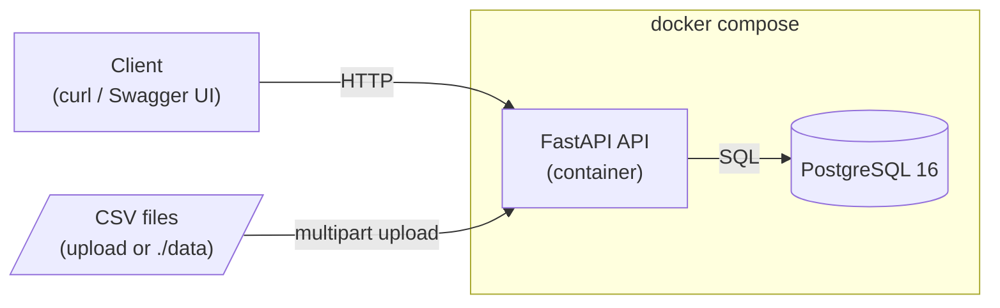
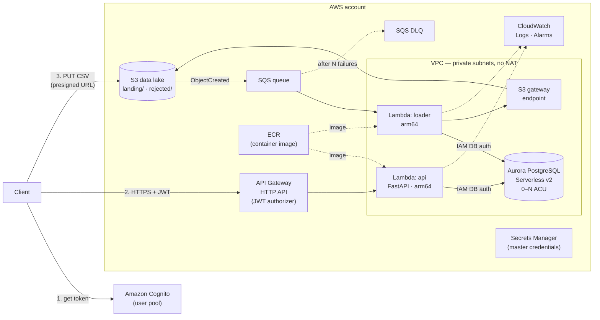
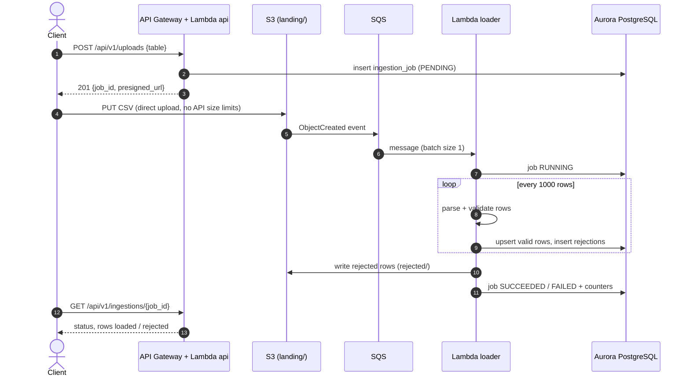
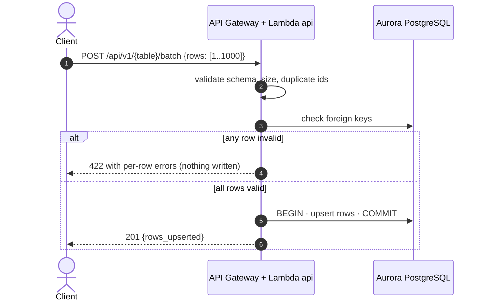
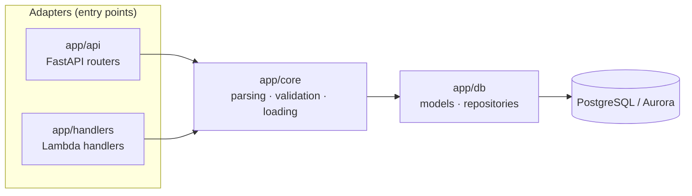

# Architecture

This document describes the target architecture of the solution, how it maps from the local
environment to AWS, and the design decisions behind it.

- [Goals and constraints](#goals-and-constraints)
- [Local architecture](#local-architecture)
- [AWS target architecture](#aws-target-architecture)
- [Data flows](#data-flows)
- [Components](#components)
- [Scalability](#scalability)
- [Cost model](#cost-model)
- [Security](#security)
- [Observability](#observability)
- [Code architecture](#code-architecture)
- [Architecture decision records](#architecture-decision-records)
- [Future evolution](#future-evolution)

## Goals and constraints

| Goal | How it is addressed |
|---|---|
| Migrate historical CSV data into a SQL database | Streaming, chunked loader with per-row validation and idempotent upserts |
| Insert batches of 1 to 1000 rows in one request | Synchronous endpoint, validated up front, single database transaction |
| Scalable | Every component scales independently; the database is protected with concurrency limits |
| Cost-efficient | Pay-per-use services only; no always-on compute, no NAT Gateway |
| Local first | Section 1 requires a **local** REST API: the same code and image run locally with Docker |

The challenge workload is a **data migration**: sporadic, bursty traffic with long idle periods.
That pattern drives the choice of a serverless, pay-per-use architecture.

## Local architecture

Locally, CSV files are uploaded to the API and processed synchronously by the same ingestion core
that runs in AWS.

## AWS target architecture

## Data flows

### Flow A — historical CSV migration (asynchronous, event-driven)

- The file **never goes through API Gateway or Lambda payloads**, so their 10 MB / 6 MB limits do
  not apply and the API does not pay to move bytes.
- SQS buffers bursts, retries failed messages and sends poison messages to a **DLQ**.
- Loads are **idempotent** (upsert by primary key): a retried message never duplicates data.
- `hired_employees` depends on `departments` and `jobs`: rows with unknown references are rejected
  with a reason. Catalog tables are loaded first.

### Flow B — batch insert of 1 to 1000 rows (synchronous)

1000 rows serialized as JSON are roughly 100 KB, well within synchronous limits.

## Components

| Component | Service | Configuration highlights |
|---|---|---|
| API entry point | API Gateway **HTTP API** | JWT authorizer (Cognito), stage throttling |
| Authentication | Amazon Cognito user pool | Client credentials / user tokens validated at the edge |
| API compute | AWS Lambda (container image, arm64) | FastAPI via AWS Lambda Web Adapter, reserved concurrency |
| Loader compute | AWS Lambda (same image, arm64) | Triggered by SQS, maximum concurrency on the event source |
| Raw storage | Amazon S3 | Private, SSE-S3, versioning, lifecycle rules on `landing/` |
| Buffering | Amazon SQS + DLQ | Visibility timeout > loader timeout, redrive after N attempts |
| Database | Aurora PostgreSQL Serverless v2 | Min 0 ACU (auto-pause) for dev, min 0.5 ACU for prod |
| Networking | VPC, private subnets | No NAT Gateway; S3 gateway endpoint |
| Secrets | Secrets Manager | Only the RDS-managed master credentials (bootstrap/migrations) |
| Images | Amazon ECR | One image for both Lambdas and local runs |
| Observability | CloudWatch Logs and Alarms | JSON logs, 14-day retention, alarms on DLQ and errors |
| Infrastructure as code | Terraform | Remote state in S3 with locking |

## Scalability

| Layer | How it scales | Limit / protection |
|---|---|---|
| Uploads | S3 scales virtually without limit | Presigned URLs expire in minutes |
| Events | SQS absorbs bursts of any size | DLQ isolates failing files |
| Compute | Lambda scales per request in seconds | Reserved / maximum concurrency |
| Database | Aurora Serverless v2 scales in fractions of an ACU in seconds | Max ACU and connection limits |

The database is the natural bottleneck, so concurrency is capped where it connects to it: each
Lambda instance holds a single reusable connection, the API function has reserved concurrency and
the loader has a maximum concurrency on its SQS trigger.

**Scaling path for very large files** (not built, documented): a single Lambda streams several GB
within its 15-minute limit by using more memory and `COPY` into a staging table. Beyond that, an
AWS Step Functions **Distributed Map** splits the CSV in S3 and processes chunks in parallel.

## Cost model

Order-of-magnitude estimates for `us-east-1`; validate with the
[AWS Pricing Calculator](https://calculator.aws/) before deploying.

| Scenario | Containers (Fargate + ALB + RDS + NAT) | **This architecture** |
|---|---|---|
| Idle, 24/7 | ~70–80 USD / month | **~1–3 USD / month** (Aurora storage, S3, one secret, logs) |
| 1M batch requests / month | Fixed cost + scaling | API Gateway ~1 USD + Lambda ~2 USD + Aurora active hours |
| 1 GB CSV migration | Absorbed by running tasks | Cents of Lambda and S3 |

Main savings:

- **No NAT Gateway** (~32 USD/month): private resources reach S3 through a free gateway endpoint.
- **No Secrets Manager interface endpoints** (~7 USD/month per AZ): Lambdas use **IAM database
  authentication**, whose token is signed locally with the function's role.
- **No RDS Proxy** for now: it has a minimum cost and keeps connections open, which would prevent
  Aurora from pausing.
- **Aurora auto-pause** (min 0 ACU): an idle database only pays for storage. Trade-off: the first
  connection after a pause takes around 15 seconds to resume.
- **arm64 (Graviton)** Lambdas are roughly 20% cheaper than x86.
- **HTTP API** is roughly 70% cheaper than API Gateway REST API.

## Security

- Aurora and Lambdas live in **private subnets** without internet access.
- Security groups allow port 5432 on Aurora **only** from the Lambda security group.
- Least-privilege IAM role per function:
  - `api`: generate presigned URLs for `landing/`, connect to the database.
  - `loader`: read `landing/`, write `rejected/`, connect to the database.
- No passwords in code or environment variables: IAM database authentication.
- S3 bucket: block public access, SSE-S3 encryption, versioning, TLS-only bucket policy.
- API protected by a Cognito **JWT authorizer** at API Gateway; the application stays auth-agnostic,
  so it also runs locally without Cognito.

## Observability

- Structured JSON logs (Powertools for AWS Lambda) with the `job_id` as correlation id.
- CloudWatch alarms: messages in the DLQ, Lambda errors and throttles, Aurora ACU utilization.
- Every CSV load is tracked in the `ingestion_jobs` table (status, rows read / loaded / rejected),
  and every invalid row in `load_rejections`, so data quality is auditable with SQL.

## Code architecture

The code follows a layered (ports and adapters) design: the ingestion core does not know whether
it is called from HTTP, from a Lambda event or from a test.

Dependencies always point towards `core`. The same loader serves the local upload endpoint and the
AWS loader Lambda.

## Architecture decision records

### ADR-001 — Serverless (Lambda) over containers (ECS Fargate)

- **Context:** sporadic migration workload with long idle periods.
- **Decision:** API Gateway HTTP API + Lambda, packaged as a container image.
- **Alternatives:** ECS Fargate + ALB has a fixed cost of ~70–80 USD/month even when idle, mostly
  due to the ALB and the NAT Gateway.
- **Consequences:** pay-per-use and per-request scaling; cold starts and a 15-minute limit per
  invocation, mitigated by the asynchronous flow. Fargate remains the right choice for high,
  constant traffic, and the same container image could run there unchanged.

### ADR-002 — PostgreSQL as the SQL database

- **Context:** transactional batch inserts with foreign keys, plus analytical queries in Section 2.
- **Decision:** PostgreSQL (Aurora PostgreSQL Serverless v2 on AWS, PostgreSQL 16 locally).
- **Alternatives:**
  - MySQL: viable, but no `FILTER` clause for the quarterly pivot.
  - SQL Server / Oracle: licensing cost without benefit.
  - Redshift: analytical engine, poor fit for small frequent inserts and high minimum cost.
  - Athena / Iceberg: not transactional for an insert API.
  - SQLite: no real concurrency, no managed cloud offering.
- **Consequences:** native upsert (`INSERT ... ON CONFLICT`), fast bulk load (`COPY`), CTEs, window
  functions and `COUNT(*) FILTER (...)`; open source and able to scale to zero on Aurora.

### ADR-003 — Direct-to-S3 uploads with presigned URLs and an SQS-triggered loader

- **Context:** CSV files can exceed API Gateway (10 MB) and Lambda (6 MB) payload limits.
- **Decision:** the client uploads to S3 with a presigned URL; `ObjectCreated` → SQS → loader Lambda.
- **Alternatives:** uploading through the API (size limits, 30-second integration timeout);
  S3 → Lambda directly (no buffering or concurrency control, harder retries).
- **Consequences:** unlimited file size, raw data kept in a data lake, retries and DLQ for free.
  Locally, a synchronous upload endpoint reuses the same loader.

### ADR-004 — Invalid rows are quarantined, not dropped

- **Context:** the provided `hired_employees.csv` has rows with missing fields.
- **Decision:** valid rows are loaded; invalid rows are stored in `load_rejections` (and in
  `rejected/` on S3) with the validation errors.
- **Consequences:** a load never fails because of a few bad rows, and data quality is auditable.

### ADR-005 — Idempotent upserts by primary key

- **Context:** event-driven processing is at-least-once; loads can be retried.
- **Decision:** `INSERT ... ON CONFLICT (id) DO UPDATE` for every write.
- **Consequences:** re-processing a file or retrying a batch never duplicates data.

### ADR-006 — No NAT Gateway, IAM database authentication

- **Context:** NAT Gateways and interface endpoints are a large share of the idle cost.
- **Decision:** S3 gateway endpoint plus IAM database authentication for the Lambdas.
- **Consequences:** near-zero idle networking cost and no runtime secrets. Lambdas cannot reach the
  internet, which the solution does not need.

### ADR-007 — Cognito JWT authorizer at API Gateway

- **Context:** the API must be protected in the cloud but runnable locally.
- **Decision:** API Gateway validates Cognito tokens before invoking the Lambda.
- **Consequences:** no authentication code in the application; HTTP APIs do not support usage-plan
  API keys, and JWT is the standard approach for them.

### ADR-008 — Terraform for infrastructure as code

- **Context:** reproducible, reviewable infrastructure.
- **Decision:** Terraform with remote state in S3.
- **Alternatives:** AWS SAM / CDK (more serverless-native, AWS-only).
- **Consequences:** cloud-agnostic tooling widely used in the industry; a plan is reviewable in PRs.

## Future evolution

- **Higher constant traffic:** raise the Aurora minimum ACU, add RDS Proxy, or move the API image to
  ECS Fargate.
- **Very large files:** `COPY` into staging tables and Step Functions Distributed Map.
- **Analytics at scale:** keep PostgreSQL as the operational store and replicate to a lakehouse
  (S3 + Iceberg + Athena) or Redshift for reporting.
- **Multi-environment:** Terraform workspaces or per-environment state for `dev` / `prod`.
